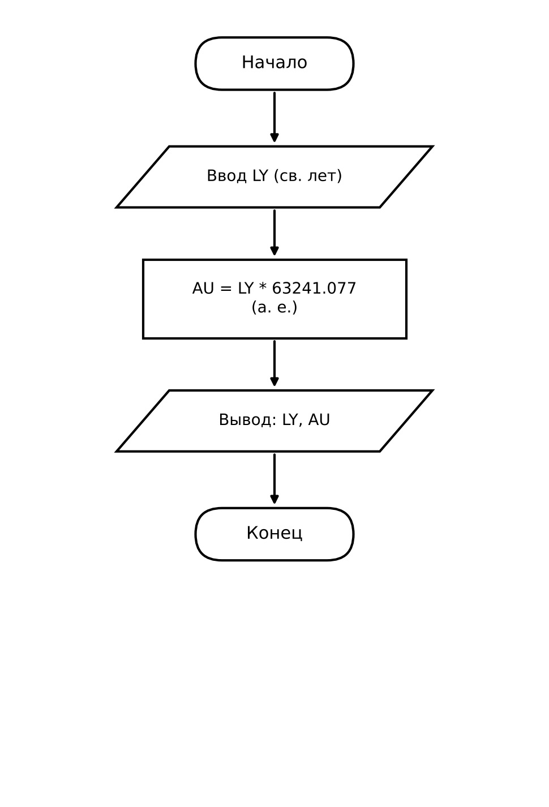

 Домашнее задание к работе 3

## Условие задачи

Написать и отладить программу пересчёта числа световых лет в астрономические единицы.

Для расчёта используется соотношение: **1 световой год ≈ 63241.077 а. е.**

* * *

## 1. Алгоритм и блок-схема

### Алгоритм

1. Задать константу `AU_IN_LY = 63241.077` (количество астрономических единиц в одном световом году).
2. Объявить переменные `ly` (световые годы) и `au` (астрономические единицы) типа `double`.
3. Запросить у пользователя число световых лет (`ly`).
4. Вычислить значение в астрономических единицах: `au = ly * AU_IN_LY`.
5. Вывести исходное значение и результат пересчёта.
6. Завершить программу.

### Блок-схема



* * *

## 2. Реализация программы

```c
#define _CRT_SECURE_NO_DEPRECATE
#include <stdio.h>
#include <stdlib.h>
#include <locale.h>

#define AU_IN_LY 63241.077

int main() {
    double ly, au;

    setlocale(LC_ALL, "Russian");

    printf("Введите число световых лет: ");
    scanf("%lf", &ly);

    au = ly * AU_IN_LY;

    printf("\n%.2f св. лет = %.2f а. е.\n", ly, au);

    system("pause");
    return 0;
}
```

* * *

## 3. Результаты работы программы

Пример работы программы при вводе **2** световых лет:

```
Введите число световых лет: 2

2.00 св. лет = 126482.15 а. е.
```

Проверка на других значениях:

| Ввод (св. лет) | Результат (а. е.) |
|----------------|-------------------|
| 1              | 63241.08          |
| 2              | 126482.15         |
| 0.5            | 31620.54          |

Пояснение:

- `au = ly * AU_IN_LY;` — оператор пересчёта световых лет в астрономические единицы.
- Для ввода значения типа `double` в `scanf` используется формат `%lf`.

* * *

## 4. Информация о разработчике

- **ФИО:Гуменников Степан Станиславович**
- **Группа:БОТИ-262** 
